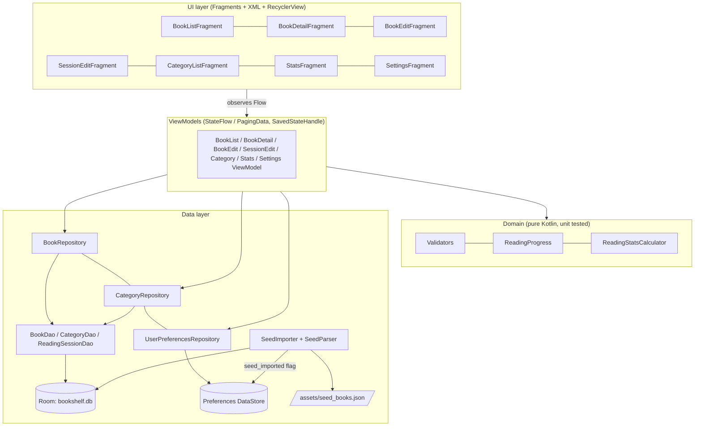

# 📚 BookShelf — Personal Library Manager

ESTIAM E5 – Mobile Apps Development – Final group project (option 1: **BookShelf**).

BookShelf is a native Android application (Kotlin, View system) to manage a personal library:
books and categories, reading sessions with automatic progress tracking, favorites,
search / filter / sort, and reading statistics with a daily goal and a reading streak.

---

## 1. Features

| Screen | What it does |
|---|---|
| **My books** (catalogue) | Paged list (Paging 3 + RecyclerView), search by title/author, filter chips (All, Favorites, Reading, Completed, Not started), category filter, sort menu, favorite toggle, empty/error states |
| **Book detail** | Category, status, rating, progress bar, description, list of reading sessions, delete a session, edit / delete the book |
| **Add / edit book** | Form with validation (required fields, numbers, ranges, current page ≤ total pages, duplicates) |
| **Log reading session** | Pages, duration, date (date picker, no future dates), note; pages ≤ remaining pages |
| **Categories** | Create / rename / delete (with confirmation, book counts, unique names) |
| **Statistics** | Daily goal progress, streak, books by status, pages, reading time, pages/hour, average rating, finish estimate, stats per category |
| **Settings** | Theme, default sort order, compact list, daily goal (DataStore) |

### Business features (real logic)
1. **Automatic reading progress** (`domain/ReadingProgress.kt`): logging a session advances the book's
   current page (capped at the total), deleting a session moves it back (never below 0), and the
   book automatically becomes *Completed* (with a `completedAt` date) or goes back to *Reading*.
   The session write and the book update run in **one Room transaction** (`BookRepository.addSession / deleteSession`).
2. **Reading statistics & goals** (`domain/ReadingStatsCalculator.kt`): daily goal %, consecutive-day
   streak, reading speed, estimated days to finish the current books, per-category breakdown.
3. **Data consistency**: deleting a book deletes its sessions (`CASCADE`); deleting a category keeps
   its books as *Uncategorized* (`SET NULL`); `(title, author)` is unique.

---

## 2. Architecture

MVVM + Repository, single activity, Navigation Component, manual dependency injection (`AppContainer`).



### Room entities and relationships

```mermaid
erDiagram
    CATEGORY ||--o{ BOOK : "categoryId (ON DELETE SET NULL)"
    BOOK ||--o{ READING_SESSION : "bookId (ON DELETE CASCADE)"
    CATEGORY { long id PK; string name UK }
    BOOK { long id PK; string title; string author; long categoryId FK; int totalPages; int currentPage; int rating; bool isFavorite; long createdAt; long completedAt }
    READING_SESSION { long id PK; long bookId FK; long date; int pagesRead; int durationMinutes; string note }
```

* Relation classes: `BookWithDetails` (`@Embedded` book + `@Relation` category + `@Relation` sessions),
  `BookListItem` (JOIN for the paged list), `CategoryWithCount`.
* **Flow**: every DAO read used by the UI returns `Flow`, so screens update automatically.
* **Paging 3**: `BookDao.pagingSource(search, categoryId, filter, sort)` → `Pager` in `BookRepository.pagedBooks`
  → `cachedIn(viewModelScope)` → `PagingDataAdapter` (`BookPagingAdapter`).
* **Search / filter / sort**: done in SQL (one query with parameters).

### Package structure
```
com.estiam.bookshelf
├── BookShelfApp.kt / MainActivity.kt   (AppContainer = manual DI, theme, seed import)
├── data
│   ├── local       Entities, Relations, DAOs, BookShelfDatabase
│   ├── repository  BookRepository, CategoryRepository
│   ├── prefs       UserPreferencesRepository (DataStore)
│   └── seed        SeedParser (Gson + validation), SeedImporter (one-time import)
├── domain          Models, Validators, ReadingProgress, ReadingStatsCalculator
└── ui              books/, sessions/, categories/, stats/, settings/, common/
```

### JSON initialization
* `app/src/main/assets/seed_books.json`: 8 categories, **24 valid books**, plus 3 records that are
  **invalid or duplicated on purpose** to show the validation (Logcat tag `SeedImporter`):
  `Rejected record #24: TITLE: REQUIRED`, `#25: CURRENT_PAGE: EXCEEDS_TOTAL, RATING: OUT_OF_RANGE`, `#26: duplicate`.
* **Validation before insertion**: `SeedParser` reuses `BookValidator` (the same rules as the form).
* **Only once**: a `seed_imported` flag is saved in DataStore after success.
* **No duplicates / no overwrite**: unique index `(title, author)` + `INSERT OR IGNORE`.

### Preferences DataStore (4 preferences, all reactive)
| Preference | Visible effect |
|---|---|
| Theme (system / light / dark) | App switches between light and dark immediately |
| Default sort order | Catalogue order (also changed from the sort menu) |
| Compact list | Catalogue switches to a one-line row layout |
| Daily goal | Goal progress on the Statistics screen |

### Screen rotation
ViewModels keep the state; search, filter, category, form category, session date and the
"form already filled" flag are stored in `SavedStateHandle`; the category dialog is a `DialogFragment`;
the date picker listener is re-attached after rotation.

---

## 3. Setup

Requirements: Android Studio (recent version), JDK 17+, Android SDK 37. Min SDK 24.

1. `git clone <repository-url>` and open the folder in Android Studio.
2. Let Gradle sync, then **Run ▶ app** on an emulator or device.
3. On the first launch, the 24 sample books are imported automatically.

Command line: `./gradlew assembleDebug` (Windows: `gradlew.bat assembleDebug`).

---

## 4. Tests

| Type | Location | Count | Command |
|---|---|---|---|
| JUnit (local JVM) | `app/src/test` | **25 tests** (validators, progress rules, statistics, seed parsing including the bundled asset) | `./gradlew testDebugUnitTest` |
| Room instrumented | `app/src/androidTest/.../data/BookShelfDatabaseTest.kt` | 4 tests (transactions, CASCADE, SET NULL, IGNORE) | `./gradlew connectedDebugAndroidTest` |
| Espresso UI | `app/src/androidTest/.../ui/BookShelfUiTest.kt` | 4 tests (launch, form validation, add book + search, bottom navigation) | `./gradlew connectedDebugAndroidTest` (emulator running) |

In Android Studio you can also right-click `app/src/test` or `app/src/androidTest` → *Run tests*.

---

## 5. Debugging

See [`docs/BUGS.md`](docs/BUGS.md): 2 documented bugs (symptoms, investigation with Logcat /
breakpoints, cause, fix). Useful Logcat tags: `SeedImporter`, `BookRepository`, `CategoryRepository`.

---

## 6. Contributions

Individual project: design, development, tests and documentation by **[Your name]**.

The work was split into four steps, each developed on its own branch and merged through a Pull Request:

| Step | Content | Branch |
|---|---|---|
| 1. Data | Room entities, DAOs, repositories, Paging 3 | `feature/data-layer` |
| 2. Books | Catalogue, detail, book form, navigation | `feature/books-ui` |
| 3. Reading | Sessions, statistics, business rules + JUnit tests | `feature/sessions-stats` |
| 4. Settings | Categories, DataStore settings, JSON seed, Espresso tests | `feature/settings-seed` |
